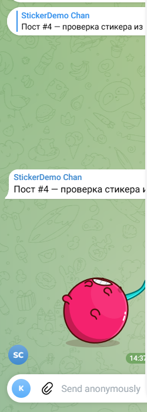

# Sticker Commenter Bot

A tiny, self-hosted Telegram bot that **automatically posts a sticker comment
under every new post in your channel** — the sticker is picked from a sticker
pack you choose, and the delay after publication is configurable.

**Live demo:** https://t.me/stickerdemo_k1 — every post in that channel got its
sticker comment from this exact code.



## How it works

Telegram channels don't really have "comments" — they have a **linked
discussion group**. Every channel post is automatically forwarded into that
group as a message with `is_automatic_forward=True`. A bot that is a member
(or admin) of the group sees that forward via `getUpdates` and replies to it
with `sendSticker`. The reply is rendered as a comment under the channel post.

No third-party services, no subscriptions — just the official Bot API.

## Setup

1. **Create a bot** with [@BotFather](https://t.me/BotFather) (`/newbot`) and
   copy the token.

2. **Give your channel a discussion group** (channel → Edit → Discussion →
   create or link a group), if it doesn't have one yet.

3. **Add the bot to the discussion group** — member is enough for posting,
   but make it an admin if the group's permissions restrict sending
   stickers/media.

4. **Find the chat IDs.** The channel and the group have numeric IDs like
   `-100xxxxxxxxxx`. Easiest way: post a test message in the channel, then call

   ```
   https://api.telegram.org/bot<TOKEN>/getUpdates
   ```

   and take `channel_post.chat.id` (channel) and `message.chat.id`
   (group) from the response.

5. **Configure and run:**

   ```bash
   pip install -r requirements.txt
   cp .env.example .env   # fill in TG_BOT_TOKEN, CHANNEL_ID, GROUP_ID, ...
   python sticker_commenter.py
   ```

   - `STICKER_SET` — sticker pack name (the part after `t.me/addstickers/`)
   - `STICKER_INDEX` — which sticker inside the pack (0 = first)
   - `DELAY_SEC` — seconds to wait after a post is published before
     commenting (the customer's requirement)

## Notes / gotchas

- The bot does **not** receive auto-forwards of posts it published itself —
  updates for your own messages aren't echoed back. Posts made by any other
  admin trigger the sticker comment as expected.
- Don't use URL hash fragments (`t.me/c/...` or `web.telegram.org/#-100...`)
  to guess chat IDs — the reliable source is `getUpdates`.
- `api.telegram.org` can be slow from some networks; the script retries
  automatically.

## Русская версия

Бот автоматически ставит **стикер-комментарий под каждым новым постом канала**:
стикер берётся из заданного стикерпака, задержка после публикации настраивается.

Демо-канал: https://t.me/stickerdemo_k1 — под постами комментарии от этого бота.

Установка: создать бота через @BotFather, привязать к каналу группу
обсуждений, добавить бота в неё, вписать `CHANNEL_ID`/`GROUP_ID` в `.env`,
запустить `python sticker_commenter.py`.

## License

MIT
